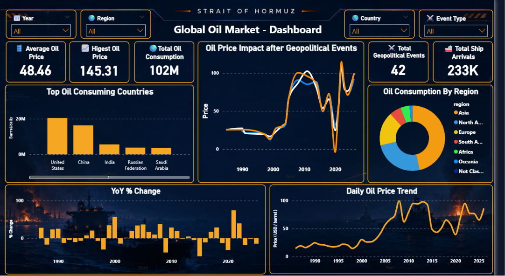

<div align="center">

# 🛢️ Global Oil Market Dashboard
### Strait of Hormuz: Geopolitical Risk & Oil Price Analysis (Power BI)


*40 years of oil price history. 211 countries. 42 crisis events. One narrow strait that moves it all.*



</div>

---

## 🌍 Overview

One narrow strait carries nearly a fifth of the world's oil supply. When war breaks out near it, prices don't just move, they swing. I wanted to see exactly how much, backed by real numbers instead of headlines. So I built an interactive Power BI dashboard that connects 40 years of crude oil data with real historical crisis events. The 2026 Strait of Hormuz crisis turned out to be one of the sharpest price shocks in that entire history.

## 🔥 Headline Insight

> The 2026 Strait of Hormuz crisis pushed crude oil prices up **57% in just 30 days**, a shock comparable to the 1990 Gulf War and one of the biggest short-term moves in four decades of price history.

## 📊 What's Inside

| Metric | What it shows |
|---|---|
| 💰 **Average / Highest Oil Price** | Daily WTI crude price trend, 1986–2026 |
| 🛢️ **Total Oil Consumption** | ~102M barrels/day across 211 countries |
| ⚡ **Oil Price Impact after Events** | Before/after price shock for 42 geopolitical events |
| 🏆 **Top Oil Consuming Countries** | US, China, India, Russia, Saudi Arabia and more |
| 🌐 **Oil Consumption by Region** | Asia, North America, Europe, South Asia, Africa, Oceania |
| 🚢 **Total Ship Arrivals** | Daily Hormuz vessel traffic: tankers, cargo, container ships |
| 📈 **YoY % Change** | Year-over-year price volatility since 1986 |
| 📉 **Daily Oil Price Trend** | Full historical time series, crisis spikes and all |

All visuals filter by **Year, Region, Country and Event Type**.

## 🗂️ Data Sources

Every dataset is labelled **Real**, **Computed** or **Modeled**, so nothing is passed off as more certain than it is.

| File (in `data/`) | Description | Type | Source |
|---|---|---|---|
| `daily_oil_price.xlsx` | Daily WTI crude spot price (1986–2026) | 🟢 Real | U.S. EIA / FRED (DCOILWTICO) |
| `crude_oil_prices.xlsx` | Monthly WTI closing price | 🟢 Real | U.S. EIA / FRED |
| `annual_avg_price.xlsx` | Annual average WTI price (1946–2026) | 🟡 Computed | Derived from EIA daily data |
| `annual_pct_change.xlsx` | Year-over-year % change | 🟡 Computed | Derived from annual averages |
| `oil_consumption.xlsx` | Consumption by country, 211 countries | 🟢 Real | EIA / Energy Institute Statistical Review |
| `ship_arrivals.xlsx` | Daily Hormuz ship arrivals (2019–2026) | 🟢 Real | IMF PortWatch |
| `oil_price_events_analysis.xlsx` | Historical oil-price events (1985–2026) | 🟢 Real (reported) | Reuters / CNBC / EIA / Wikipedia |
| `event_price_impact.xlsx` | Price before/after each event | 🟡 Computed | Event dates joined to daily WTI |
| `hormuz_dependency_score.xlsx` | Country exposure index (41 countries) | 🔵 Modeled | Author's own composite index |

## 🧹 The Real Work: Cleaning the Data

Building the dashboard was the easy part. Making the data trustworthy was not:

- ✅ Verified 10,000+ daily price rows line by line against official EIA history
- ✅ Reconciled 211 countries of consumption data until it matched the published global total **exactly**
- ✅ Recomputed annual averages and YoY changes from raw daily data and cross-checked them against EIA's own figures
- ✅ Cross-referenced every historical event across multiple news and reference sources for date accuracy
- ✅ Clearly flagged modeled data (like the Hormuz Dependency Score) as an original estimate, not an official statistic

## 🛠️ Methodology

1. **Collect** raw data from EIA, FRED, IMF PortWatch and verified news/reference sources.
2. **Clean** in Excel: standardise dates, units and country names so everything joins cleanly.
3. **Reconcile** totals (e.g. consumption summed and checked against the official global figure).
4. **Compute** derived metrics: annual averages, YoY %, and T-7 / T+7 / T+30 event price impact.
5. **Model** the Hormuz Dependency Score from LNG exposure %, SPR buffer days and trade dependence.
6. **Label** every dataset by confidence level for full transparency.
7. **Build** in Power BI: relationships, DAX measures and the final report page.

## 📁 Repository Structure

```
strait-of-hormuz/
├── data/                          # 9 cleaned datasets (see Data Sources)
│   ├── daily_oil_price.xlsx
│   ├── crude_oil_prices.xlsx
│   ├── annual_avg_price.xlsx
│   ├── annual_pct_change.xlsx
│   ├── oil_consumption.xlsx
│   ├── ship_arrivals.xlsx
│   ├── oil_price_events_analysis.xlsx
│   ├── event_price_impact.xlsx
│   └── hormuz_dependency_score.xlsx
├── dashboard/
│   └── strait_of_hormuz.pbix      # Power BI report
├── images/
│   └── dashboard_preview.png
└── README.md
```

## ▶️ How to Open

1. Install [Power BI Desktop](https://powerbi.microsoft.com/desktop/) (free).
2. Open `dashboard/strait_of_hormuz.pbix`.
3. Filter by year, region, country or event type.

## ⚠️ Disclaimer

Independent analysis built for portfolio and educational purposes. The Hormuz Dependency Score is a self-built composite model, not an official government or institutional statistic. Data is sourced from public references believed reliable as of the dashboard's last update.

---

## 👤 Author

**Abhishek Kumar** · MIS Data Analyst  
[LinkedIn](https://www.linkedin.com/in/abhikumar8762/) · [GitHub](https://github.com/abhishek8762a) · [Portfolio](https://abhishek-portfolio-8762.vercel.app) · [Email](mailto:abhiyadav8762@gmail.com)

Found a data discrepancy or want to talk methodology? Open an issue or reach out.
